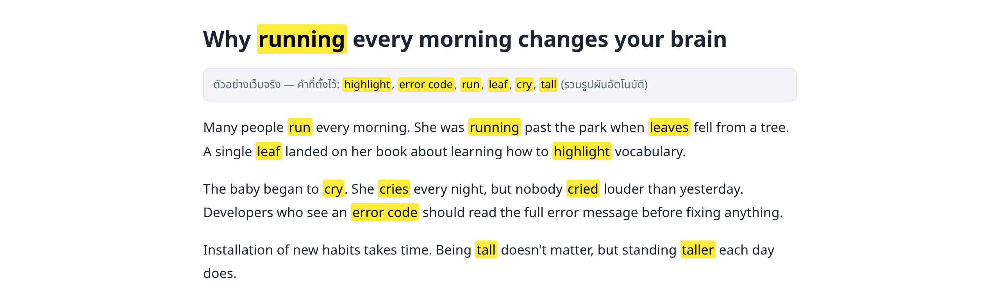
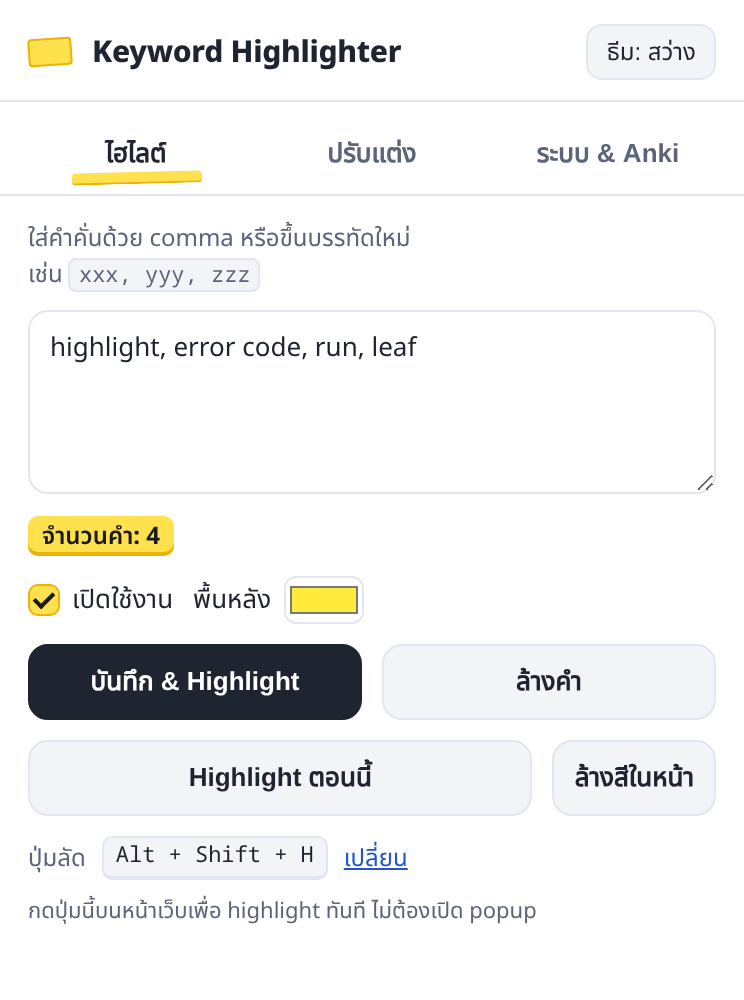
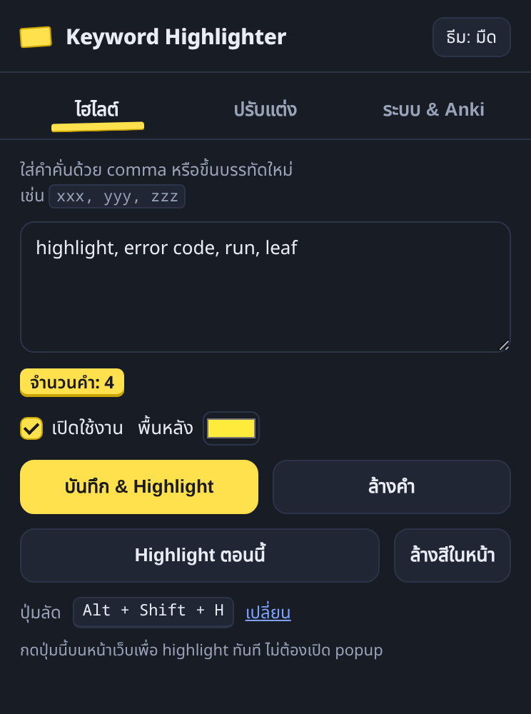
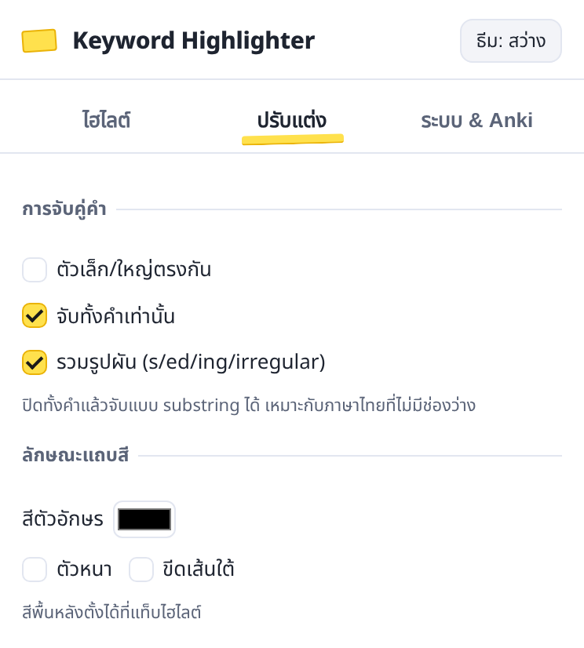
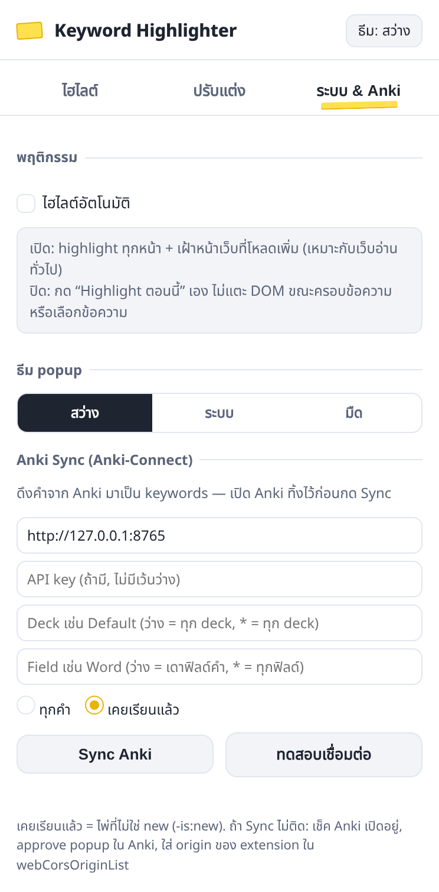

<div align="center">

**🌐 Language:** [English](README.md) | [ไทย](README.th.md)

</div>

---

<div align="center">

# Keyword Highlighter

**Highlight the words you're learning, right on the page you read.**

A Chrome extension for language learners, readers, and Anki users.<br />
Customizable colors, auto vs. manual modes, and built-in dark mode.

[](https://developer.chrome.com/docs/extensions/develop/migrate/what-is-mv3)
[](https://www.google.com/chrome/)
[](https://foosoft.net/projects/anki-connect)
[](LICENSE)



<sub>Type a word once — <code>run</code> matches <code>running</code>, <code>cry</code> matches <code>cries / cried</code>, <code>error code</code> wins over bare <code>error</code></sub>

</div>

---

## Features

- **Highlight everywhere** — enter words once, they apply to every tab
- **Automatic inflection matching** — `cry` matches `cries`, `cried`, `crying`; `go` matches `went`; `leaf` matches `leaves`
- **Unicode whole-word matching** — `tall` won't match inside `Installation` (disable for substring matching, e.g. Thai)
- **Longest match wins** — `error code` is matched before `error`
- **Sync from Anki** — pull words from a chosen deck via Anki-Connect
- **Light / Dark / System** — remembers your theme choice
- **Manual mode** — stops all observers, highlight on demand, text selection never breaks
- **Customizable shortcut** — press `Alt + Shift + H` to highlight instantly, or rebind it

## Screenshots

| Real web page | Popup — Highlight tab (light / dark) |
| --- | --- |
|  |   |

| Customize tab | System & Anki tab |
| --- | --- |
|  |  |
| Word matching + highlight appearance | Auto/manual behavior + theme + Anki Sync |

> All screenshots are generated from the real UI with `npm run shots` — see [Regenerating screenshots](#regenerating-screenshots-docs--shots).

---

## Requirements

| Item | Version / notes |
| --- | --- |
| Chrome, Edge, Brave, or Chromium | Manifest V3 support (Chrome 88+) |
| Node.js | Only for running tests / generating screenshots — v18+, v22 recommended |
| Anki + Anki-Connect | Only for Sync — add-on code `2055492159` |
| Git | For cloning the project |

---

## Installation

### Option 1 — Load unpacked (for dev / personal use)

1. Clone or download the project:
   ```bash
   git clone https://github.com/not6248/chrome-highlight-extension.git
   cd chrome-highlight-extension
   ```
   Or click **Code → Download ZIP** on GitHub and extract it.
2. Open `chrome://extensions` in Chrome / Edge / Brave.
3. Enable **Developer mode** (top-right corner).
4. Click **Load unpacked** and select the `chrome-highlight-extension` folder.
5. Pin the extension icon to the toolbar for quick popup access.
6. Open any web page and press `Alt + Shift + H` — yellow highlights mean it works.

To reload after code changes: go back to `chrome://extensions` and hit **Reload** on this extension.

### Option 2 — Install ZIP from Releases (no git needed)

1. Go to the repo's **Releases** page.
2. Download `chrome-highlight-extension-vX.Y.Z.zip` and extract it.
3. Follow steps 2–5 of Option 1.

> To share with a friend: send them the zip built in [Packaging as ZIP](#packaging-as-zip-for-sharing-or-store-submission) and have them follow this option.

### Option 3 — Chrome Web Store

Not published yet — use Option 1 or 2 for now.

---

## Quick start in 30 seconds

1. Click the extension icon.
2. Type the words to highlight in the first field, separated by commas or new lines:
   ```
   highlight, error code, run, leaf
   ```
3. Click **Save & Highlight**.
4. Open any web page and compare with `docs/highlight-demo.png` above.

> [!TIP]
> To pull words from Anki, go to the **System & Anki** tab, enter the URL, and click **Sync Anki** — words are merged into your list automatically.

---

## The three tabs

| Tab | What's there |
| --- | --- |
| **Highlight** | Your words, on/off toggle, background color, save and highlight-now buttons |
| **Customize** | Case sensitivity, whole-word, inflection matching, text color, bold, underline |
| **System & Anki** | Auto/manual mode, theme, Anki connection |

Frequently changed options live on the first tab; the rest moved to advanced tabs to keep it clean.

## Auto vs. manual mode

| | Auto mode (default) | Manual mode |
| --- | --- | --- |
| Highlight on page load | Immediately | Only when you press the button |
| Late-loaded content (infinite scroll / SPAs) | Watched via DOM observer | Not watched |
| Popup color/word changes | Applied instantly | Stored, applied on button press |
| While selecting text | Highlight deferred | Never touches the DOM |

**Why manual mode exists** — when you select text with another extension (or drag a selection), the observer's text-node replacement destroys the selection. Manual mode removes the MutationObserver entirely, so selection stays stable.

In manual mode, use **Highlight now** on the first tab (it saves your latest settings first).

## Keyboard shortcut

Default: **`Alt + Shift + H`** — works on any web page, no popup needed.

To rebind: on the **Highlight** tab click **Change** next to the shortcut, then press your key combo.

- Must include `Ctrl`, `Alt`, or `Meta` (Shift optional)
- `Backspace` clears the shortcut, `Esc` cancels
- Works when focus is on the page, using the last saved settings

---

## Build / Dev — is a build step needed?

**No build needed.** This is a pure Manifest V3 project (plain HTML + CSS + JS) — no bundler, no transpile. Load the folder into Chrome directly.

`npm install` exists for two things only: running tests and generating `docs/*.png`.

```bash
npm install        # first time only (installs playwright-core for tests)
npm test           # unit + browser tests (auto-starts test server)
npm run test:anki      # Anki-Connect tests only
npm run test:shortcut  # shortcut tests only
npm run test:highlight # highlight tests only (TEST_URL=... supported)
npm run shots      # regenerate popup screenshots into docs/
```

| Command | What it does |
| --- | --- |
| `npm test` | Runs `test-anki.mjs` + `test-shortcut.mjs` + `test-highlight.mjs` in sequence |
| `TEST_URL=http://... npm run test:highlight` | Tests highlighting against another URL instead of `test-page.html` |
| `CHROME=/path/to/chrome npm run shots` | Generates screenshots with a different Chrome (defaults to Playwright Chromium) |

### Bumping the version

Update both places to match, then reload the extension:

1. `manifest.json` → `"version": "1.5.0"`
2. `package.json` → `"version": "1.0.0"` (recommended: keep them in sync)

### Packaging as ZIP (for sharing or Store submission)

```bash
# from the project root
zip -r chrome-highlight-extension-v1.5.0.zip . \
  -x "node_modules/*" ".git/*" "docs/*" "*.log" ".DS_Store"
```

Attach this zip to a GitHub Release or upload it to the [Chrome Web Store Developer Dashboard](https://chrome.google.com/webstore/devconsole).

### Regenerating screenshots (`docs/` + `shots`)

The 4 popup screenshots are generated by `scripts/screenshot.mjs` with Playwright (mocks `chrome.*` and opens the real `popup.html`):

```bash
npm run shots
# produces docs/popup-light.png, popup-dark.png, popup-style.png, popup-system.png
```

`docs/highlight-demo.png` is generated from the real pipeline (`parseKeywords → expandKeywords → buildHighlightRegex` from `highlight.js`) injected into a sample page — if you change matching logic, re-run tests + regenerate screenshots.

---

## Anki Sync

1. Keep Anki open.
2. Install the **Anki-Connect** add-on (code `2055492159`) and restart Anki.
3. In the **System & Anki** tab:
   - **URL** — `http://127.0.0.1:8765`
   - **API key** — only if enabled in Anki-Connect
   - **Deck** — e.g. `Default` (empty = all decks)
   - **Field** — e.g. `Word` (empty = guess word field, `*` = all fields)
   - **Mode** — `All words` or `Learned only` (`-is:new`)
4. Click **Sync Anki** and wait for the confirmation message.

The extension tries `POST /api/v1` (JSON-RPC 2.0) first, then falls back to `POST /` (API v6).

## Matching rules

```
tall        → tall, taller, tallest        (not inside Installation)
cry         → cry, cries, cried, crying
leaf        → leaf, leaves
run         → run, runs, ran, running
error code  → whole phrase wins over single word
```

- **Case sensitivity** — off by default
- **Whole-word** — Unicode boundaries, works with Thai and digits
- **Unbuildable regex input** — skipped safely, never breaks the page
- Never touches `input`, `textarea`, `select`, `script`, `style`, or contenteditable

## Project structure

```
chrome-highlight-extension/
├── manifest.json        # MV3, permissions: storage + <all_urls>
├── popup.html           # 3-tab UI + light/dark themes
├── popup.js             # load/save settings, tab switching, Anki sync
├── content.js           # text-node walker, highlighting, observer, manual mode
├── content.css          # styles for span.ce-highlight
├── shortcut.js          # parse/match user-defined shortcuts
├── highlight.js         # parse keywords, expand inflections, build trie regex
├── anki.js              # Anki-Connect client + storage helper
├── test-*.mjs           # unit + browser tests
├── scripts/screenshot.mjs
├── test-page.html       # test page
└── docs/                # README images
    ├── highlight-demo.png
    ├── popup-light.png
    ├── popup-dark.png
    ├── popup-style.png
    └── popup-system.png
```

## Privacy

- Words and settings live only in your browser's `chrome.storage`
- Keywords are stored in `storage.local` since they may exceed `storage.sync` quota
- No analytics, no external servers
- Anki-Connect only talks to `127.0.0.1` as you configured

## Troubleshooting

| Symptom | Try this |
| --- | --- |
| Nothing highlights | Check it's enabled, and refresh pages loaded before install |
| Selection disappears when annotating | Enable manual mode in the **System & Anki** tab |
| Sync fails | Keep Anki open, check Anki-Connect, approve the Anki popup, add the extension origin to `webCorsOriginList` |
| Thai words don't match | Turn off **whole-word only** for substring matching |
| Color change has no effect | In manual mode you must press **Highlight now** |
| Shortcut doesn't work | Focus must be on the page (not the address bar), and the combo must not clash with Chrome's |
| Load unpacked errors | Select the folder containing `manifest.json` at its top level, not a nested folder |

## License

ISC — see [LICENSE](LICENSE) for details.
