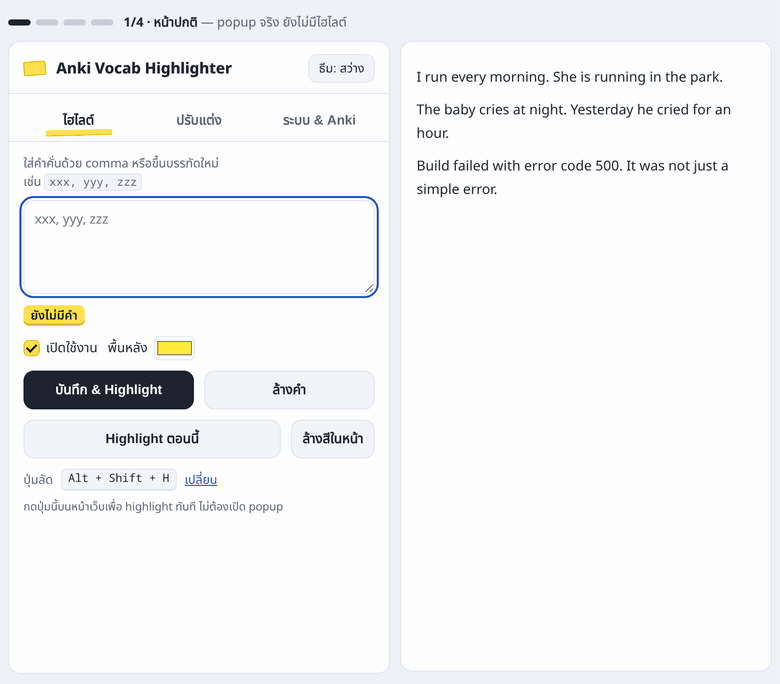
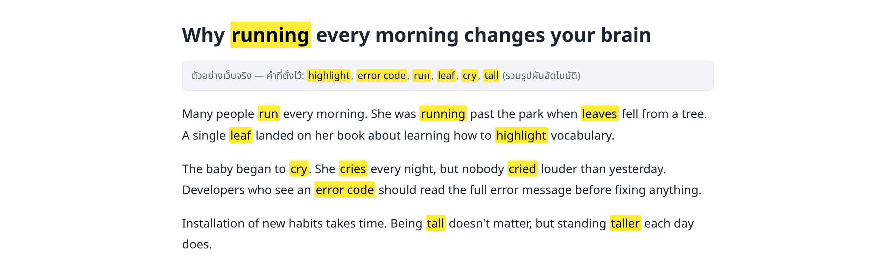
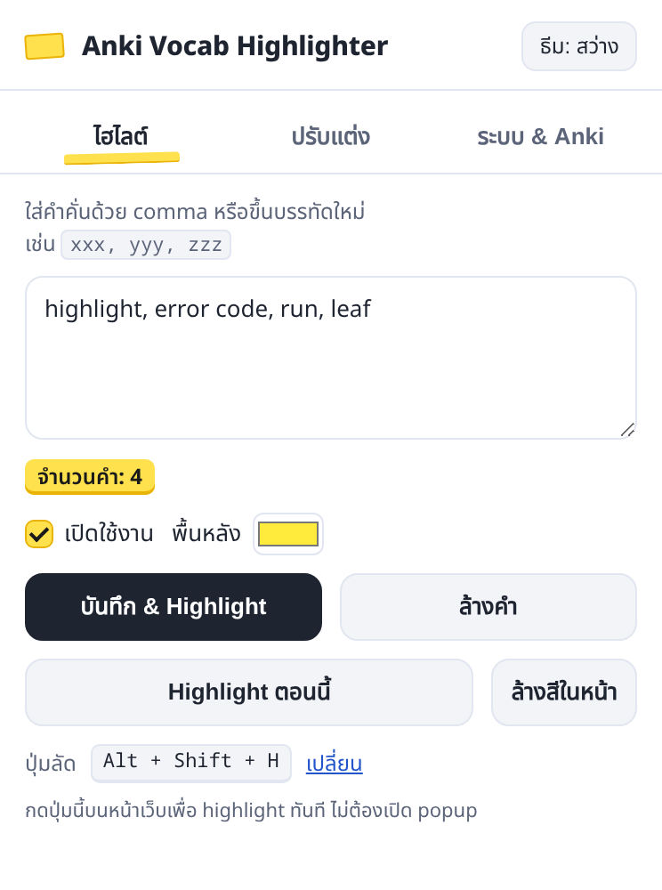
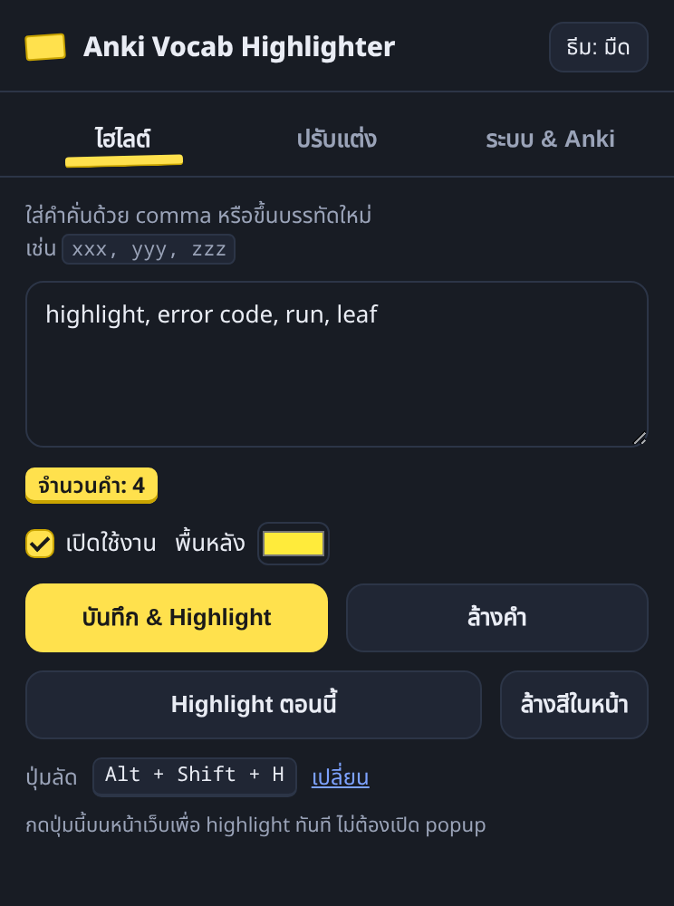
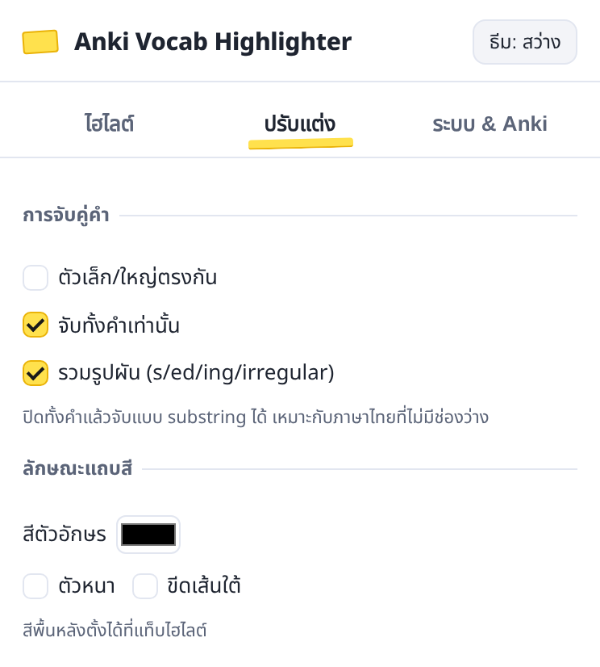
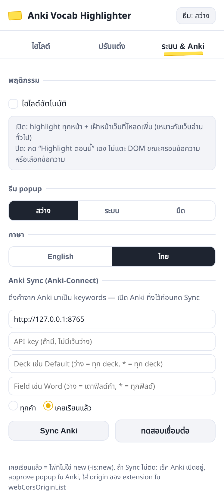

<div align="center">

**🌐 Language:** [English](README.md) | [ไทย](README.th.md)

</div>

---

<div align="center">

# Anki Vocab Highlighter

**ไฮไลต์คำที่กำลังเรียน ตรงบนหน้าที่คุณอ่าน**

A Chrome extension to highlight vocabulary you're learning on any web page — built for language learning with Anki sync.<br />
ส่วนขยาย Chrome สำหรับคนเรียนภาษา นักอ่าน และสาย Anki ปรับสีได้ตามใจ แยกโหมดอัตโนมัติกับ manual และมี dark mode ในตัว



[](https://developer.chrome.com/docs/extensions/develop/migrate/what-is-mv3)
[](https://www.google.com/chrome/)
[](https://foosoft.net/projects/anki-connect)
[](LICENSE)

<sub>พิมพ์คำครั้งเดียว — <code>run</code> โดนทั้ง <code>running</code>, <code>cry</code> โดนทั้ง <code>cries / cried</code>, <code>error code</code> ชนะ <code>error</code> ตัวเดี่ยว</sub>

</div>

---

## ทำอะไรได้บ้าง

- **ไฮไลต์ทุกเว็บ** — ใส่คำครั้งเดียว ใช้ได้ทุกแท็บที่เปิด
- **จับรูปผันอัตโนมัติ** — `cry` โดนทั้ง `cries`, `cried`, `crying`; `go` โดน `went`; `leaf` โดน `leaves`
- **จับทั้งคำแบบ Unicode** — `tall` ไม่ไปโดนใน `Installation` หรือ `taller` (ปิดได้ถ้าอยากจับ substring เช่นภาษาไทย)
- **คำยาวชนะคำสั้น** — `error code` ถูกจับก่อน `error`
- **Sync จาก Anki** — ดึงคำจาก deck ที่เลือกผ่าน Anki-Connect
- **UI ไทย + อังกฤษ** — เปลี่ยนภาษาได้ที่แท็บระบบ (ค่าเริ่มต้นภาษาอังกฤษ)
- **Light / Dark / ตามระบบ** — จำธีมที่เลือกไว้
- **โหมด manual** — หยุด Observer ทั้งหมด กดปุ่มเองเมื่อพร้อม เลือกข้อความได้ไม่หลุด
- **ปุ่มลัดตั้งเองได้** — กด `Alt + Shift + H` เพื่อ highlight ทันที หรือเปลี่ยนเป็นปุ่มที่ถนัด

## ภาพหน้าจอ

| หน้าเว็บจริง | Popup — แท็บไฮไลต์ (สว่าง / มืด) |
| --- | --- |
|  |   |

| แท็บปรับแต่ง | แท็บระบบ & Anki |
| --- | --- |
|  |  |
| การจับคู่คำ + ลักษณะแถบสี | พฤติกรรม auto/manual + ธีม + ภาษา + Anki Sync |

> ภาพเวอร์ชันภาษาอังกฤษของทุก popup อยู่ข้าง ๆ กันในชื่อ `docs/popup-*.png`

> ภาพทั้งหมดสร้างจากของจริงด้วย `npm run shots` ดูวิธีทำเพิ่มในหัวข้อ [สร้างภาพหน้าจอใหม่](#สร้างภาพหน้าจอใหม่-docs--shots)

---

## สิ่งที่ต้องมี

| อย่าง | เวอร์ชัน / หมายเหตุ |
| --- | --- |
| Chrome, Edge, Brave หรือ Chromium | รองรับ Manifest V3 (Chrome 88+) |
| Node.js | เฉพาะคนจะรันเทสต์ / สร้างภาพ — v18+ แนะนำ v22 |
| Anki + Anki-Connect | เฉพาะคนจะใช้ Sync — add-on code `2055492159` |
| Git | สำหรับ clone โปรเจกต์ |

---

## ติดตั้ง

### วิธีที่ 1 — Load unpacked (สำหรับ dev / ใช้เองตอนนี้)

1. Clone หรือดาวน์โหลดโปรเจกต์:
   ```bash
   git clone https://github.com/not6248/anki-vocab-highlighter.git
   cd anki-vocab-highlighter
   ```
   หรือกด **Code → Download ZIP** บน GitHub แล้วแตกไฟล์
2. เปิด `chrome://extensions` ใน Chrome / Edge / Brave
3. เปิด **Developer mode** ที่มุมขวาบน
4. กด **Load unpacked** แล้วเลือกโฟลเดอร์ `anki-vocab-highlighter`
5. ปักหมุดไอคอนส่วนขยายไว้บน toolbar เพื่อเปิด popup ได้เร็ว
6. เปิดเว็บอะไรก็ได้ กด `Alt + Shift + H` ถ้าเห็นแถบเหลือง = ติดตั้งสำเร็จ

อัปเดตโค้ดแล้วอยากโหลดใหม่: กลับมาที่ `chrome://extensions` กดปุ่ม **Reload** ของส่วนขยายนี้

### วิธีที่ 2 — โหลด ZIP จาก Releases (ไม่ต้องใช้ git)

1. ไปที่หน้า **Releases** ของ repo นี้
2. ดาวน์โหลด `anki-vocab-highlighter-vX.Y.Z.zip` แตกไฟล์
3. ทำขั้นตอน 2–5 ของวิธีที่ 1 เหมือนเดิม

> อยากแจกให้เพื่อน: ส่งไฟล์ zip ที่สร้างจากหัวข้อ [แพ็กเป็น ZIP](#แพ็กเป็น-zip-แจกหรือส่ง-store) ให้เพื่อนทำตามวิธีนี้ได้เลย

### วิธีที่ 3 — Chrome Web Store

ยังไม่ publish — ระหว่างนี้ใช้วิธีที่ 1 หรือ 2 ไปก่อน

---

## เริ่มใช้ใน 30 วินาที

1. กดไอคอนส่วนขยาย
2. พิมพ์คำที่อยากไฮไลต์ในช่องแรก คั่นด้วย comma หรือขึ้นบรรทัดใหม่
   ```
   highlight, error code, run, leaf
   ```
3. กด **บันทึก & Highlight**
4. เปิดเว็บอะไรก็ได้ แล้วดูผลตามภาพ `docs/demo-th.gif` ด้านบน (ดู `docs/highlight-demo.png` เพิ่มในหัวข้อภาพหน้าจอ)

> [!TIP]
> ถ้าอยากได้คำจาก Anki ไปที่แท็บ **ระบบ & Anki** กรอก URL แล้วกด **Sync Anki** คำจะถูก merge เข้า list ให้อัตโนมัติ

---

## สามแท็บ ตั้งค่าอย่างไรให้เจอ

| แท็บ | ใช้อะไร |
| --- | --- |
| **ไฮไลต์** | คำที่ต้องการ, เปิด/ปิด, สีพื้นหลัง, ปุ่มบันทึก และปุ่มสั่ง highlight |
| **ปรับแต่ง** | ตัวเล็ก/ใหญ่, จับทั้งคำ, รวมรูปผัน, สีตัวอักษร, ตัวหนา, ขีดเส้นใต้ |
| **ระบบ & Anki** | โหมดอัตโนมัติ/manual, ธีม, ภาษา, การเชื่อมต่อ Anki |

ตัวเลือกที่เปลี่ยนบ่อยอยู่แท็บแรก ที่เหลือย้ายไปแท็บขั้นสูงเพื่อให้หน้าแรกโล่ง

## อัตโนมัติ หรือ manual

| | โหมดอัตโนมัติ (ค่าเริ่มต้น) | โหมด manual |
| --- | --- | --- |
| Highlight ตอนเปิดหน้า | ทำทันที | รอจนกดปุ่ม |
| เนื้อหาโหลดเพิ่ม (infinite scroll / SPA) | เฝ้า DOM ให้อัตโนมัติ | ไม่เฝ้า DOM |
| เปลี่ยนสี/คำใน popup | เห็นผลทันที | เก็บค่าไว้ รอกดปุ่ม |
| ขณะลากเลือกข้อความ | เลื่อน highlight ออกไปก่อน | ไม่แตะ DOM เลย |

**ทำไมต้องมี manual** — ตอนครอบข้อความด้วย extension อื่นหรือตอนลาก selection การ replace text node ของ Observer จะทำให้ selection หาย โหมด manual ตัด MutationObserver ทิ้งทั้งหมด จึงเลือกและครอบข้อความได้นิ่งๆ

เมื่ออยู่ในโหมด manual ใช้ปุ่ม **Highlight ตอนนี้** บนแท็บแรก (ปุ่มนี้จะบันทึกค่าล่าสุดให้ก่อนเสมอ)

## ปุ่มลัด

ค่าเริ่มต้นคือ **`Alt + Shift + H`** ใช้ได้ทันทีบนหน้าเว็บ โดยไม่ต้องเปิด popup

เปลี่ยนปุ่มได้ที่แท็บ **ไฮไลต์** → กด **เปลี่ยน** ข้างปุ่มลัด แล้วกดชุดปุ่มที่ต้องการ

- ต้องมี `Ctrl`, `Alt` หรือ `Meta` (Shift ใส่หรือไม่ก็ได้)
- `Backspace` ล้างปุ่มลัด, `Esc` ยกเลิก
- ปุ่มจะทำงานเมื่อโฟกัสอยู่บนหน้าเว็บ และใช้ค่าล่าสุดที่บันทึกไว้

---

## Build / Dev — ต้อง build ไหม?

**ไม่ต้อง build** โปรเจกต์นี้เป็น Manifest V3 ล้วน (HTML + CSS + JS ธรรมดา) ไม่มี bundler ไม่มี transpile โหลดโฟลเดอร์เข้า Chrome ได้เลย

`npm install` มีไว้สำหรับ 2 อย่างเท่านั้น: รันเทสต์ และสร้างภาพ `docs/*.png`

```bash
npm install        # ครั้งแรกเท่านั้น (ลง playwright-core สำหรับเทสต์)
npm test           # unit + browser test (auto-start test server)
npm run test:anki      # เทสต์ Anki-Connect อย่างเดียว
npm run test:shortcut  # เทสต์ปุ่มลัดอย่างเดียว
npm run test:highlight # เทสต์ highlight อย่างเดียว (TEST_URL=... ได้)
npm run shots      # สร้างภาพ popup ใหม่ลง docs/
```

| คำสั่ง | ทำอะไร |
| --- | --- |
| `npm test` | รัน `test-anki.mjs` + `test-shortcut.mjs` + `test-highlight.mjs` ต่อกัน |
| `TEST_URL=http://... npm run test:highlight` | ทดสอบ highlight กับเว็บอื่นแทน `test-page.html` |
| `CHROME=/path/to/chrome npm run shots` | ใช้ Chrome ตัวอื่นสร้างภาพ (ค่าเริ่มต้นใช้ Playwright Chromium) |

### เปลี่ยนเวอร์ชัน

แก้เลขใน 2 ที่ให้ตรงกัน แล้ว reload extension:

1. `manifest.json` → `"version": "1.5.0"`
2. `package.json` → `"version": "1.0.0"` (ถ้าจะให้ตรงกันแนะนำตั้งให้เท่ากัน)

### แพ็กเป็น ZIP (แจกหรือส่ง Store)

```bash
# จาก root ของโปรเจกต์
zip -r anki-vocab-highlighter-v1.5.0.zip . \
  -x "node_modules/*" ".git/*" "docs/*" "*.log" ".DS_Store"
```

เอาไฟล์ zip นี้ไปแนบใน GitHub Releases หรืออัปโหลดขึ้น [Chrome Web Store Developer Dashboard](https://chrome.google.com/webstore/devconsole) ได้เลย

### สร้างภาพหน้าจอใหม่ (`docs/` + `shots`)

ภาพ popup ทั้ง 4 ไฟล์สร้างจาก `scripts/screenshot.mjs` ด้วย Playwright (mock `chrome.*` แล้วเปิด `popup.html` จริง):

```bash
npm run shots
# ได้ 8 ไฟล์: docs/popup-{light,dark,style,system}.png (UI อังกฤษ)
#           + docs/popup-{light,dark,style,system}-th.png (UI ไทย)
npm run gif
# ได้ docs/demo.gif (UI อังกฤษ: 780px, 10fps, วนซ้ำไม่จำกัด)
npm run gif:th
# ได้ docs/demo-th.gif (UI ไทย) ผ่าน scripts/demo-gif.mjs --lang=th + ffmpeg
```

ภาพ `docs/highlight-demo.png` สร้างจาก pipeline จริง (`parseKeywords → expandKeywords → buildHighlightRegex` จาก `highlight.js`) แล้วฉีดลงหน้าเว็บตัวอย่าง — ถ้าแก้ตรรกะการจับคู่ ควรรันเทสต์ + ถ่ายภาพใหม่เสมอ
ภาพ `docs/demo.gif` (UI อังกฤษ) และ `docs/demo-th.gif` (UI ไทย) ใช้ pipeline เดียวกัน: เปิด `test-page.html` พิมพ์ `run, cry, error code` กด Save & Highlight (โดนทั้ง `running`, `cried`) และโชว์ว่า `error code` ถูกจับทั้งวลี

---

## Sync Anki

1. เปิด Anki ค้างไว้
2. ติดตั้ง add-on **Anki-Connect** (code `2055492159`) แล้ว restart Anki
3. ในแท็บ **ระบบ & Anki** ตั้งค่า:
   - **URL** — `http://127.0.0.1:8765`
   - **API key** — ใส่ถ้าเปิดใช้ใน Anki-Connect
   - **Deck** — เช่น `Default` (เว้นว่าง = ทุก deck)
   - **Field** — เช่น `Word` (เว้นว่าง = เดาฟิลด์คำ, `*` = ทุกฟิลด์)
   - **โหมด** — `ทุกคำ` หรือ `เคยเรียนแล้ว` (`-is:new`)
4. กด **Sync Anki** แล้วรอข้อความยืนยัน

ส่วนขยายจะลอง `POST /api/v1` (JSON-RPC 2.0) ก่อน แล้ว fallback ไป `POST /` แบบ API v6

## การจับคู่คำ

```
tall        → tall, taller, tallest        (ไม่โดน Installation)
cry         → cry, cries, cried, crying
leaf        → leaf, leaves
run         → run, runs, ran, running
error code  → จับทั้งวลีก่อนคำเดี่ยว
```

- **ตัวเล็ก/ใหญ่** — ไม่สนโดยค่าเริ่มต้น
- **จับทั้งคำ** — ใช้ Unicode boundary รองรับภาษาไทยและตัวเลข
- **คำที่ build regex ไม่ได้** — ข้ามอย่างปลอดภัย ไม่ทำให้ทั้งหน้าพัง
- ไม่แตะ `input`, `textarea`, `select`, `script`, `style` และ contenteditable

## โครงสร้างโปรเจกต์

```
anki-vocab-highlighter/
├── manifest.json        # MV3, permissions: storage + <all_urls>
├── popup.html           # UI 3 แท็บ + ธีม light/dark
├── popup.js             # โหลด/บันทึกค่า, สลับแท็บ, sync Anki
├── content.js           # เดิน text node, highlight, observer, manual mode
├── content.css          # สไตล์ของ span.ce-highlight
├── shortcut.js          # parse/เทียบปุ่มลัดที่ผู้ใช้ตั้งเอง
├── highlight.js         # parse keywords, ขยายรูปผัน, สร้าง trie regex
├── anki.js              # Anki-Connect client + storage helper
├── test-*.mjs           # unit + browser tests
├── scripts/screenshot.mjs
├── scripts/demo-gif.mjs
├── test-page.html       # หน้าเว็บสำหรับเทสต์
└── docs/                # ภาพประกอบ README
    ├── demo.gif            # GIF สาธิต UI อังกฤษ
    ├── demo-th.gif         # GIF สาธิต UI ไทย
    ├── highlight-demo.png
    ├── popup-light.png
    ├── popup-dark.png
    ├── popup-style.png
    ├── popup-system.png
    ├── popup-light-th.png (UI ไทย)
    ├── popup-dark-th.png (UI ไทย)
    ├── popup-style-th.png (UI ไทย)
    └── popup-system-th.png (UI ไทย)
```

## ความเป็นส่วนตัว

- คำและตั้งค่าอยู่ใน `chrome.storage` ของเบราว์เซอร์คุณเท่านั้น
- keywords เก็บใน `storage.local` เพราะอาจใหญ่กว่า quota ของ `storage.sync`
- ไม่มี analytics ไม่มี server ภายนอก
- Anki-Connect คุยกับ `127.0.0.1` ตามที่คุณตั้งไว้เท่านั้น

## แก้ปัญหาที่เจอบ่อย

| อาการ | ลองทำ |
| --- | --- |
| ไม่ highlight บนหน้าเว็บ | เช็คว่าเปิดใช้งานอยู่ และหน้าเว็บโหลดก่อน extension ติดตั้งหรือไม่ (refresh หน้า) |
| Selection หายขณะครอบข้อความ | เปิดโหมด manual ในแท็บ **ระบบ & Anki** |
| Sync ไม่ติด | เปิด Anki, เช็ค Anki-Connect, approve popup ใน Anki, ใส่ origin ใน `webCorsOriginList` |
| คำภาษาไทยไม่โดน | ปิด **จับทั้งคำเท่านั้น** เพื่อจับแบบ substring |
| เปลี่ยนสีแล้วไม่เห็นผล | โหมด manual ต้องกด **Highlight ตอนนี้** |
| ปุ่มลัดไม่ทำงาน | เช็คว่าโฟกัสอยู่บนหน้าเว็บ ไม่ใช่ในช่อง address bar และปุ่มไม่ชนกับ shortcut ของ Chrome |
| Load unpacked แล้ว error | เช็คว่าเลือกโฟลเดอร์ที่มี `manifest.json` อยู่ชั้นนอกสุด ไม่ใช่โฟลเดอร์ซ้อน |

## License

ISC — ดูรายละเอียดใน [LICENSE](LICENSE)
